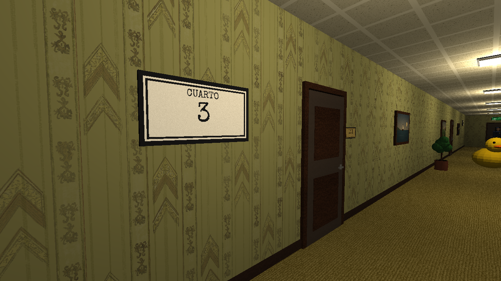

# NO MIRES DOS VECES

*Todo parece normal. Hasta que te das cuenta de que no lo está.*

Juego en primera persona para Game Jam (tema **Something's Off**). Eres el vigilante del turno de noche de un pasillo de oficinas
que **se repite**: cada vez que cruzas la puerta del fondo vuelves a entrar en el mismo pasillo. Unity **6000.5.5f1** (vale cualquier Unity 6) · C#.



> Las imágenes de `Capturas/` son **vistas previas renderizadas fuera de Unity** con el código real del nivel, no capturas del motor.

---

## Cómo se juega (el bucle)

1. Entras en el **cuarto 0**. Mario, tu compañero, te explica las reglas. Memoriza el pasillo.
2. Cruza la puerta del fondo → entras otra vez en **el mismo pasillo** (el cartel de la pared dice en qué cuarto estás).
3. En cada cuarto puede haber **una anomalía** (algo distinto) o ninguna:
   - **Si algo cambió:** apúntalo y pulsa **E** para reportarlo. Después cruza la puerta.
   - **Si todo está normal:** no reportes nada. Cruza la puerta.
4. Si sales con una anomalía **sin reportar**, o reportaste algo **normal**, vuelves al **cuarto 0**.
5. Encadena **8 cuartos** sin fallar y la puerta te llevará a la salida.

### Un solo modo que se vuelve más difícil

| Cuartos | Anomalías | Suspenso y sustos |
|---|---|---|
| 0 | Ninguna (intro: memoriza el pasillo, Mario te explica) | — |
| 1 – 2 | 1, siempre de las claras | A veces un susto |
| 3 – 5 | 1 o 2, aparecen las sutiles, a veces una ocurre estando dentro | La sombra, pasos detrás de ti, sustos frecuentes |
| 6 – 7 | **Hasta 3 a la vez** (máximo), más cosas que cambian estando dentro | Casi siempre hay susto, a veces dos |

**Sustos** (siempre **delante** de ti; no cuentan como anomalía, solo asustan): apagón con la sombra plantada delante en la oscuridad,
golpes en la puerta que tienes delante, una sombra que aparece de golpe frente a ti con un grito, un susurro delante en el pasillo.
Desde el cuarto 3, si se te escapa una anomalía, además hay grito.

### La sombra
Desde el cuarto 3, a veces una silueta negra con tu misma gorra aparece **detrás de ti** y te persigue susurrando.
Si no la miras, corre; si la miras, casi se para. **Solo es un susto**: si te alcanza, grita y desaparece. No cuenta como anomalía
ni te devuelve al cuarto 0. Si la reportas con E... te da un susto y se deshace en el aire.

## "Espera. ¿Qué?" — los giros

- **Mario sabe demasiado** (y habla con voz de murmullos). Te explica las reglas en el cuarto 0, pero luego aparece sabiendo en qué cuarto vas,
  qué fue lo último que reportaste (aunque él "no estaba en ese cuarto") y cuántas veces volviste al cuarto 0.
  Si lo reportas a él, se ofende... y cuenta como fallo. Cerca del final insinúa que el que se repite eres tú.
- **La regla cambia sin avisar.** Una vez por partida (en el cuarto 4) la puerta del fondo no abre y el cartel
  de salida dice **ATRÁS**: el camino es volver por la puerta por la que entraste.
- **El escenario reacciona a ti.** *Otro vigilante*, idéntico a ti, aparece al fondo: cuando caminas, camina hacia ti con tus
  mismos pasos, como un espejo; cuando te paras, se para. Desde el cuarto 3, en algunos cuartos, oyes **pasos detrás de ti** que imitan los tuyos.
- **Lo absurdo.** Un **pato de goma gigante** en mitad del pasillo (cuac). Un **retrato que eres tú**. El **cartel del cuarto con el número equivocado**.
- **Una mecánica común esconde algo.** En el último cuarto, la pausa no es "PAUSA": es **"NO PUEDES PARAR AHORA"** y el botón dice "...VALE".
- **El final.** Mario te espera en la sala blanca: *"Nos vemos mañana. Mismo turno. Mismo pasillo."*

## Las 22 anomalías posibles

Cuadro torcido · Figura en el cuadro · Retrato con ojos vacíos / **El retrato eres tú** · Puerta entreabierta · Número de puerta (666) ·
Planta más grande · Reloj al revés · Silla desaparecida · Silla girada · Monitor encendido ("TE VEO") · Póster cambiado ·
Días sin incidentes (127 → 0) · Fuente de agua desaparecida · Cajón abierto · Huellas en la pared · Silla de más ·
Alguien al fondo · Luz apagada · Cartel de salida ("NO SALGAS") · **Número del cuarto equivocado** · **Pato de goma gigante** · **Otro vigilante**  (+ la sombra, que solo asusta)

---

## Instalación

1. Crea un proyecto **Unity 6** con la plantilla **Universal 3D** (recomendada) o **3D (Built-in)**.
2. Copia la carpeta **`Assets/`** de este paquete dentro del proyecto (si ya tenías una versión anterior, **reemplaza** la carpeta `Assets` entera).
3. Vuelve a Unity y espera a que compile. Se configura solo: materiales, texturas, escena principal abierta e iconos del Editor ocultos.
4. Pulsa **Play**.

Si algo no se configuró: menú **No Mires Dos Veces → 1. Configurar todo**.

## Controles

| Tecla | Acción |
|---|---|
| W A S D / flechas | Moverse |
| Shift | Correr |
| Ratón | Mirar |
| **E** o clic izquierdo | Reportar anomalía / abrir puerta |
| V | Primera / tercera persona |
| Esc | Pausa (opciones: sensibilidad, volumen, brillo, invertir Y) |
| R | Reiniciar (en pausa o al ganar) |
| F2 *(solo Editor / Development Build)* | Muestra qué tiene el cuarto actual (para probar) |
| F1 *(solo Editor / Development Build)* | Hace aparecer ya la anomalía que iba a ocurrir estando dentro |

---

## Estructura del proyecto

```
Assets/
  Scenes/Main.unity              Escena principal (GameManager + vista previa del pasillo en el Editor)
  Scripts/
    Core/      GameManager (bucle de cuartos, Mario, giros), GameUI (interfaz), SoundManager, GameInput, Options, GameSettings, GameBootstrap
    Player/    PlayerController (movimiento, cámara 1ª/3ª persona), PlayerAvatar (cuerpo animado), AnomalyReporter (tecla E)
    Anomalies/ Anomaly (base), Reportable, TransformAnomaly, VisibilityAnomaly, TextureSwapAnomaly, LightAnomaly,
               ClockAnomaly, MirrorGuardAnomaly (otro vigilante), ShadowChaserAnomaly (la sombra), IdleDriver (Mario), FaceCamera
    World/     LevelBuilder (todo el pasillo), LevelPreview, ExitDoor, WallClock, Interactable
    Util/      MaterialLibrary, MeshUtil, MeshLoader, GameAssets, ViewUtil
  Editor/NoMiresDosVecesTools.cs Configuración automática + menú (materiales, texturas, escena, compilar, ocultar iconos)
  Resources/   Textures (25) · Sprites (39) · Audio (26 .wav) · Fonts · Models (silla) · Materials (se crean solos)
  Art/Models/chair.obj · ThirdParty/Licencias/
Herramientas/GeneradoresDeAssets/  Scripts de Python que generaron imágenes, sonidos y texturas
Capturas/                          Vistas previas
```

El pasillo se construye por código (`LevelBuilder`) **en cada cuarto**, así cada vuelta empieza limpia y con su propia anomalía.

## Ajustar

Todo en `Assets/Scripts/Core/GameSettings.cs`: cuartos por dificultad, probabilidad de anomalía, máximo de cuartos normales
seguidos, anomalías retrasadas, eco de pasos, velocidad y alcance de la E. Los textos de Mario están en `GameManager.ScriptMario`.

## Assets y licencias

| Asset | Origen | Licencia |
|---|---|---|
| Texturas de pared, moqueta, techo y lámpara | [Backrooms Textures](https://github.com/amini-allight/backrooms-textures) | CC0 |
| Silla 3D + texturas | [Poly Haven – Plastic Monobloc Chair 01](https://polyhaven.com/a/plastic_monobloc_chair_01) | CC0 |
| Relieve de tela de la ropa | [Poly Haven – Fabric Pattern 07](https://polyhaven.com/a/fabric_pattern_07) | CC0 |
| Sonidos (pasos, puerta, reloj, susurros, neón, estática, dron, pato, voz de Mario) | [Freesound.org](https://freesound.org) — autores en `Licencias/Sonidos.txt` | Ver cada enlace |
| Música del menú y de fondo, latido, error, susto, tono de sala | [Pixabay](https://pixabay.com/) | Licencia de Pixabay |
| Fuente *Special Elite* | [Google Fonts](https://fonts.google.com/specimen/Special+Elite) | Apache 2.0 |
| Fuente *Creepster* | [Google Fonts](https://fonts.google.com/specimen/Creepster) | SIL OFL 1.1 |

Todo lo demás (cuadros, carteles, números de cuarto, retrato del vigilante, pato, el resto de sonidos, personajes animados) se creó para este juego.
Licencias completas en `Assets/ThirdParty/Licencias/`.

## Compilar para Windows

Menú **No Mires Dos Veces → 3. Compilar para Windows (64-bit)** → `Builds/Windows/NoMiresDosVeces.exe`.

---

## Estado de verificación

- **Sí:** los scripts compilan sin errores ni avisos (compilador de C#) contra declaraciones de la API de Unity, en tres configuraciones.
  El nivel, las 22 anomalías y los personajes se ejecutaron en una simulación y se renderizaron (imágenes de `Capturas/`);
  cada anomalía se reporta una sola vez y el nivel vuelve exactamente al estado inicial.
- **No:** no se ha abierto ni jugado dentro de Unity, ni compilado el `.exe`. El flujo del bucle (puertas, fundido, contador, Mario)
  está revisado en el código pero no probado jugando.

### Lista de pruebas

1. Menú → JUGAR. Mario te habla al acercarte. El cartel dice CUARTO 0.
2. Cruza la puerta del fondo → fundido "CUARTO 1", apareces al principio del mismo pasillo.
3. Cuarto con anomalía: repórtala (destello + campana) y cruza → sube el cuarto. No la reportes → "Se te pasó algo... cuarto 0".
4. Reporta algo normal → aviso; al cruzar, cuarto 0.
5. Cuarto 4: la salida no abre y dice ATRÁS → vuelve por la puerta de entrada → "Espera... ¿qué?" y sube el cuarto.
6. Esc en el último cuarto → "NO PUEDES PARAR AHORA".
7. Cuarto 8 → la puerta da a la sala blanca, Mario se despide → HAS SALIDO.
8. Desde el cuarto 3: sombra, sustos, 2-3 anomalías a la vez.

### Si algo falla

- **"Display 1 – No cameras rendering":** no has pulsado Play. (Desde esta versión la ventana Game ya muestra el pasillo con una cámara de vista previa.)
- **Error rojo `UnityConnectWebRequestException: Token Exchange failed`:** no es del juego; es Unity intentando conectar con tu cuenta.
  Comprueba internet, vuelve a iniciar sesión en Unity Hub, o ignóralo (pulsa *Clear* en la consola). No afecta al juego ni a la compilación.

- **Todo rosa:** *No Mires Dos Veces → Avanzado → Regenerar materiales*.
- **Iconos de bombillas o altavoces:** son del Editor; *No Mires Dos Veces → Ocultar iconos del Editor* o apaga **Gizmos** en la ventana Game.
- **Errores en rojo en la consola:** copia el texto y pásamelo.
